<!-- ═══════════════════════════  HERO  ═══════════════════════════ -->

  

  

  
  
  
  

---

### 🔬 Research in progress

| | Project | What it asks |
|:-:|---|---|
| 🪜 | **[authz-ladder](https://github.com/ftaakash/authz-ladder)** | Regression-tests authorization invariants in Dataspace Protocol connectors (Eclipse EDC), using already-patched CVEs as the correctness oracle. |
| 🔒 | **[MCP-Lock](https://github.com/ftaakash/MCP-Lock)** | Provenance-aware pre-install verification for coding agents: check the MCP server *before* it runs. |
| 🧾 | **[PDR](https://github.com/ftaakash/PDR)** | Provenance Debt at Resolution: what you inherit the moment a dependency resolves. |
| 🔥 | **[Hades](https://github.com/ftaakash/Hades)** | What helps when telemetry lies? |

### 🛠️ Things I've shipped

| | Project | Stack |
|:-:|---|---|
| 🏥 | **[DischargeFlow](https://github.com/ftaakash/DischargeFlow)** · AI-powered hospital discharge management |  |
| 🧠 | **[SkillGraph](https://github.com/ftaakash/SkillGraph)** · upload a résumé, get your skill graph and a plan to close the gaps |  |

---

### ⚙️ Toolbox

  

---

### 📈 Telemetry (the honest kind)

  

---

### 🚀 My contribution graph

  

---

  

  

